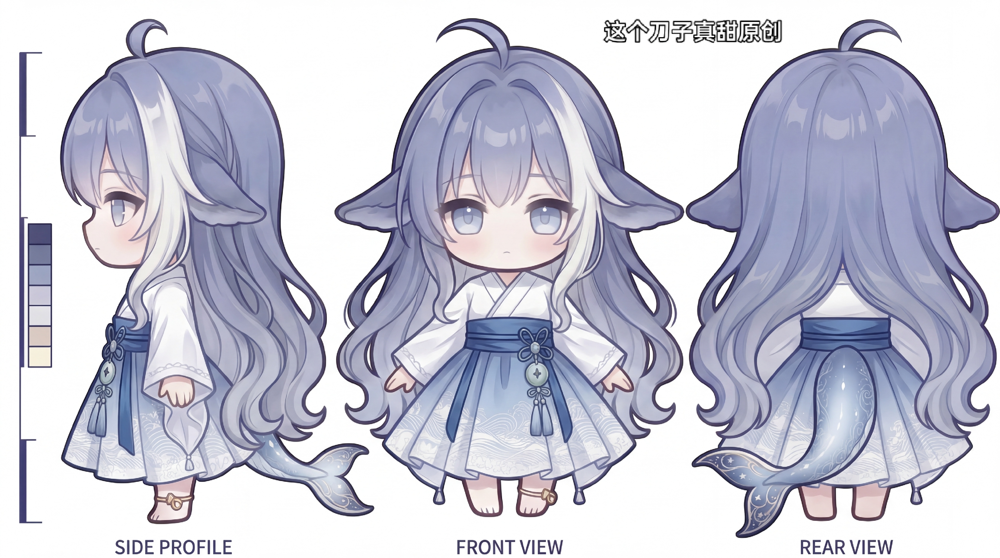

# vbcpet — AI Agent 的 Character Runtime

**vbcpet 不只是一个桌宠，而是一套 AI Agent 的「角色运行时（Character Runtime）」。**
ESP32-P4 是它的第一种身体，Live2D / VRM / PNG 帧序列是它现在的三张脸，未来可扩展到手机、机器人等更多载体。

> **一条链路讲清楚**：AI Agent（Claude Code / Codex / Cursor …）产生事件 →
> Character Runtime 把事件翻译成表情 / 动作 / 台词 / 状态 →
> **同一份角色画面同时驱动「PC 桌面透明窗口」和「ESP32-P4 硬件屏」**。
>
> 角色表现参考 Neuro-sama，语音链路参考 xiaozhi-esp32。
> 完整设计见 [`docs/architecture.md`](docs/architecture.md)、[`docs/plan.md`](docs/plan.md)、[`docs/decisions.md`](docs/decisions.md)。



---

## 一、这是什么

传统桌宠是「一个会动的图片」；vbcpet 想做的是**给 AI Agent 一副能被看见的身体**：

| 层次 | 做什么 | 在本仓库里的实现 |
|------|--------|------------------|
| **角色表现层** | 把「Agent 在干什么」翻译成表情、动作、台词、心情值 | `live2d/render*.html` + soullink 情绪引擎 + Director |
| **Agent 接入层** | 接各种 AI Agent，拿到工作状态与工具授权请求 | `pc-host/*_driver.py` + `risk.py` + `agent_bridge.py` |
| **输出宿主层** | 同一份画面同时上桌面窗口和硬件屏 | Electron 透明窗口 + 串口 JPEG 推流 + WebRTC 视频轨 |
| **身体（硬件）** | 屏幕、触摸、按键、麦克风/喇叭、六轴、SD、NFC、摄像头、WiFi | `firmware/` + `firmware_c6/` + `hardware/` |

两条并行的落地路线，共用同一套渲染页与同一套情绪 API：

- **蓝图层（WebRTC）**：`pc-host/host.py` 作为 WHIP 服务端，向 P4 推视频轨 + 双 DataChannel，P4 侧最终做硬解显示与传感器回传（对应 ADR-001/002/006/007/008）。
- **实机层（当前在跑）**：V1 板屏幕挂在 UART0/CH340 上，PC 用 Playwright 截 Live2D 画面 → JPEG → `FRAME:` 协议 → 2M 串口 → P4 PPA 硬解上屏。**这条路已经把 Live2D 实时动画打上真机屏幕。**

---

## 二、功能特性（详细）

### 2.1 角色表现：三套模型、一套 API

同一套 `window` API（`applyEmotion / setMood / sendMessage / playMotion / setExpression / getStatus`）被三种渲染页实现，宿主可以随便换：

| 渲染页 | 模型 | 特点 | 用法 |
|--------|------|------|------|
| `live2d/render.html` | **Live2D Hiyori**（Cubism 4） | 表现力最强，10 个真实 motion + 5 组表情预设 + 原生眨眼；引擎版本实测锁死 `pixi.js@8.19.0` + `@jannchie/pixi-live2d-display@1.3.0` | 默认 |
| `live2d/render_png.html` | **大肥鱼 PNG 帧序列** | 零 WebGL 依赖、极轻量，28 组状态动画（idle / 走路 / 摸头 / 吃 / 睡 / 生气 / 拖拽 / 落地 …），3 档精灵尺寸 187 / 238 / 306 | `--mode png` |
| `live2d/render_vrm.html` | **VRM / GLB**（three.js + `@pixiv/three-vrm`） | 用户可导入自己的模型（仓库自带 `aldina.vrm` / `Lazuli_VRM.vrm` / `Zome.vrm`，均可提取表情与元数据） | `--mode vrm --model models/xxx.vrm` |

配套能力：

- **动作队列 v3** — 解决 PixiJS v8 与 Cubism 的 WebGL buffer 冲突：不再持续跑 idle 动画，而是 `idle(~4.7s) → 表情(2.5s) → 下一段 idle` 的队列循环，保留原生眨眼与自然运动。
- **情绪系统（soullink-emotion 集成）** — 内置 1400 条中文语料的 `MessageReactionClassifier`，消息 → 情绪分类（VAD 驱动）→ 参数增强层（低头 / 歪头 / 脸红 / 微笑）→ `setParameterValue`，屏幕右上角 OSD 实时显示 emotion / variant / mood。详见 [`docs/live2d-soullink.md`](docs/live2d-soullink.md)。
- **心情值 Mood** — 0–100（基线 60），由 Agent 工作状态偏移（thinking −2 / editing +3 / done +8 / error −15 …）+ 用户行为偏移（发消息 +3 / 允许 +5 / 拒绝 −3）+ 闲置回归（≥15s 后每 10s 向 60 漂移 1 点）共同驱动；`serial_bridge.py` 控制台可用 `mood+10` / `mood-5` 手动微调。渲染页按分区映射表情（0–25 angry / 25–45 sad / 45–65 neutral / 65–80 happy / 80+ surprised）。当前心情值作用在 PC 渲染页上，尚未随串口下发到硬件。
- **表情调参工具** — `live2d/tune_expressions.html`，可视化滑块实时调 13 个面部参数。
- **换皮工具链** — `docs/live2d-comfyui.md` + `docs/live2d-reskin.md`：把 Hiyori 贴图拆成区块 → ComfyUI 逐块生成新形象 → 拼回，`tools/l2d_batch.py`、`tools/live2d_repack.py` 负责批量与打包。

### 2.2 输出宿主：桌面 + 硬件「双显联动」

| 宿主 | 实现 | 说明 |
|------|------|------|
| **PC 桌面透明窗口** | `live2d/electron/`（Electron） | 无边框 / 透明 / 可置顶 / 可拖动 / 带托盘；支持 stdin 一行 JSON 事件驱动 |
| **PC 桌面推流到硬件** | `pc-host/desktop_pet_display.py` | 「双显中枢」：同一个事件源同时广播给桌面窗口和 P4 串口推流 |
| **WebRTC 视频轨** | `pc-host/live2d_track.py` | Playwright 无头截图 → PIL → numpy → PyAV → H.264 VideoTrack，帧率标称 ~30FPS |
| **串口直推** | `pc-host/stream_final.py` / `stream_simple.py` / `serial_bridge.py` | 真机在跑的方案，见 2.4 |

```powershell
# 桌面窗口 + P4 推流，同一个模型、同一套情绪事件
python pc-host/desktop_pet_display.py --mode live2d --port COM16
python pc-host/desktop_pet_display.py --mode png --size 306 --res 480x800 --port COM16
python pc-host/desktop_pet_display.py --mode vrm --model models/myAvatar.glb --no-p4   # 只桌面
```

### 2.3 Agent 接入与「按键授权」

把「被控制的 AI 代理」抽象成统一的 `AgentDriver`（`pc-host/agent_driver.py`），驱动通过回调把状态推给 host：

`on_status`（thinking / running / editing / done / error）、`on_say`、`on_panel`（token 用量）、`on_permission`（工具授权）。

| `--driver` | 实现 | 授权方式 | 成本 |
|---|---|---|---|
| `fake`（默认） | 脚本化假代理，完整事件流 | 假授权回路 | 零 |
| `demo` | host.py 内置演示循环 | — | 零 |
| `claude` | Claude CLI 子进程（stream-json 双向） | `control_request` / `control_response` | API 费 |
| `claude-sdk` | Claude Agent SDK，`can_use_tool` 回调 | **硬件四按键直连** → `Allow` / `Deny` / `yes_always` | API 费 |

- **Director（可插拔）** — `heuristic`（零成本正则清洗 + 首句提取 + 关键词情绪）或 `openai`（任意 OpenAI 兼容端点，做文本压缩 + 情绪标签），对应 ADR-003。
- **Risk Classifier 三层分级**（ADR-008） — Low 自动放行 / Medium 等按键 / High 强制确认 + RGB 红：`risk.classify(tool_name, tool_input) → (RiskLevel, reason)`。
- **Agent 中转站** `pc-host/agent_bridge.py` — 不重开会话（省上下文成本），而是用 UI 自动化把文字注入当前 VS Code 对话窗口、轮询会话文件实时监工、再把结果压缩后回传硬件（TTS / 字幕）。
- **轻量聊天模式** `pc-host/chat_driver.py` — 直连 Anthropic 兼容端点，不带工具与 Claude Code 系统提示，token / 成本相比 dev 模式降约 90%，用于「桌宠生活聊天」场景。

### 2.4 固件（ESP32-P4，ESP-IDF v5.5.3）

模块化拆分，`firmware/main/` 下各司其职：

| 模块 | 职责 |
|------|------|
| `vbcpet_main.c` / `bringup.c` | 主入口 + bring-up 自检框架（控制台 `test <name>` / `test all` / `brightness` / `ldo <n> <mv>` / `dl` / `gp <pin>` / `scan`）；自检项 `buttons / leds / touch / audio / imu / sd / servo / nfc / usb / display` |
| `transport_uart.c` / `transport_usb.c` / `transport.h` | 传输后端抽象：UART0@2M（复用作控制台+推流）或 USB Serial JTAG |
| `channel_demux.c` | **demux v2**：二进制自同步，在字节流任意位置扫描 `FRAME:` 魔数（JPEG 误同步概率 ≈2⁻⁴⁸），失步最多丢一帧 |
| `display_pipeline.c` / `display_pipeline_dsi.c` / `display_backend.h` | 显示后端抽象 + DSI 实现；PPA 硬件 JPEG 解码 480×800 RGB565 → PSRAM 帧缓冲 → DPI 上屏 |
| `text_render.c` / `text_input.c` / `interaction_engine.c` | 7548 个 CJK 字形（SimSun 16×16）透明背景渲染、自动滚动、行超时保护（500ms） |
| `peripherals/` | 按键 `buttons`、SK6812 状态灯、触摸 `touch`、音频 `audio`（I2S + ES7210 ADC + ES8311 DAC + NS4150 PA）、六轴 `mpu6500`、`sd_card`、舵机 `servo`、`nfc`、`usb_host`、`i2c_bus` 与 `self_test` 自检 |
| 摄像头 OV5640（MIPI-CSI） | ⬜ 硬件与引脚已定（MCLK=GPIO5 / RSTB=GPIO12 / PWDN=GPIO13，共享 I2C），**固件待写**；分步方案与官方驱动限制见 [`docs/wifi-camera-bringup.md`](docs/wifi-camera-bringup.md) |
| `peripherals/wifi_link.c` | **esp-hosted + esp_wifi_remote**：WiFi 在模组里的 C6 上，P4 侧提供 `wifi scan / info / conn / status` 控制台命令 |
| `peripherals/c6_flash.c` | **P4 作为 C6 的串口编程器**（官方 `esp-serial-flasher`）：C6 只引出 UART + BOOT strap、没有 EN，所以必须由 P4 代刷；支持 `c6flash` / `c6mon` 与「开机自动刷」Kconfig |
| 显示后端 SPI（开发板） | ST7789V，SPI Mode 0 @10MHz，240×320，13.8fps @2M |

关键协议与实测数字：

```
帧协议:  FRAME:<8位hex长度>\n + <JPEG 载荷>      (载荷 ≤ 64KB, demux 缓冲上限)
实测:    V1 最终板 480×800 @ quality 70 → ~42KB/帧 @ ~2.5fps (COM8 @ 2M)
         开发板   240×320 @ quality 80 → 12~14KB/帧 @ 13.8fps
显示链路: HW reset → LDO VO3 2500mV 供 DSI PHY → PLL locked → DSI 2-lane 820Mbps
         → ST7102 屏厂 GX09C init 序列 → DPI 视频 → 背光 PWM(GPIO48)
```

### 2.5 硬件

主控 **ESP32-P4C6-Core**（鱼鹰光电，P4 双核 360MHz + C6 WiFi6/BLE5，32MB PSRAM + 16MB Flash，88pin 邮票孔），屏幕 **YDP430BT009-V1**（4.3" IPS 480×800，ST7102 MIPI-DSI + 触摸，与模组同厂）。

原理图


PCB


- **外设拓展已实装**：USB-A 外设口（FS OTG）、MPU-6500 六轴、microSD（SDIO 4-bit）、舵机 ×4（云台 Yaw/Pitch + 2 预留）、IP5306 电池、OV5640 摄像头（MIPI-CSI 2-lane）、NT3H2111 NFC、PN532 兼容。
- **电源架构**：USB-C → CH224K（PD 9V，5V 回退）→ MP2315 Buck 3.3V@2A → 模组与外设；LDO 1.8V（触摸 / codec IO）；MT3608 升压驱动屏背光（8 LED 4S2P，恒流 R5 = 15Ω）。
- **PCB**：8 组差分对（DSI / CSI 100Ω = 7.3mil，USB 90Ω = 9.5mil）、L2 功率电感足迹修正、电源线宽审查 —— 详见 [`hardware/pcb-layout-guide.md`](hardware/pcb-layout-guide.md)。
- **文档齐全**：[`hardware/bom.md`](hardware/bom.md)（BOM 全部定稿）、[`hardware/final-pinmap.md`](hardware/final-pinmap.md)（88pin 完整分配）、[`hardware/power-tree.md`](hardware/power-tree.md)、[`hardware/expansion.md`](hardware/expansion.md)、[`hardware/upgrade-roadmap-v2.md`](hardware/upgrade-roadmap-v2.md)。

### 2.6 工具链

| 工具 | 用途 |
|------|------|
| `tools/ai_flash.py` | **AI 友好的烧录入口**：自动找口 / 构建 / 烧录 / 抓日志 / 下发 `test all` 自检，支持 `--json`、`--kill-stale`、`--erase`、`--dry-run` |
| `tools/flash-v1/` | V1 板 strap 烧录三件套（`build_osptek.bat` / `flash_osptek.ps1` / `sync_flash3.ps1`）+ 说明 |
| `firmware/esp32p4-usj-flash.cfg` / `usj_flash.tcl` | OpenOCD：走 USB-Serial-JTAG 的免 strap 烧录/调试通道 |
| `tools/serial_console.py` | 非交互串口控制台（可 `--send` 命令、`--log` 落盘），修过「吃首字符」问题 |
| `tools/gp_sweep.py` | GPIO / LDO 逐脚电平扫描（配合万用表记录），V1 板 IO 供电大案就是它扫出来的 |
| `tools/schematic_snapshot.py` / `schematic_review.py` | 解析嘉立创 `.epro2` → 元件+网络清单；自动审查 USB 极性 / 悬空 / 连接完整性 |
| `tools/enet_review.py` | 原理图 `.enet` 与 PCB `.enet` 的一致性比对 |
| `tools/gen_font.py` | 生成固件用 CJK 点阵字库 |
| `tools/l2d_batch.py` / `live2d_repack.py` | Live2D 贴图区块批量处理 / 拆包与重打包 |
| `tools/extract_vrm_meta.mjs` | 提取 VRM 模型元数据（人设、许可、骨骼信息） |

---

## 三、系统架构

### 3.1 蓝图：WebRTC 双通道（M2.5 已完成，硬件侧待接）

```
AI Agent (Claude Code / Codex / Cursor …)
        ↓  Agent Event Stream
┌─ Character Runtime (PC) ──────────────┐
│  Director · Emotion · Risk Classifier │
│  Animation Scheduler                  │
└──────────────┬────────────────────────┘
               ↓  WebRTC (双 DataChannel + 视频轨 + 音频轨)
┌─ ESP32-P4 Runtime ────────────────────┐
│  Sensors · Servos · Audio · RGB       │
└──────────────┬────────────────────────┘
               ↓  BLE + WiFi Direct
        手机 App (可选高保真 Live2D)
```

- **Character Event Protocol** — 所有事件统一 schema，5 类事件源 × 16 种事件类型（[ADR-006](docs/decisions.md)），Python + C 双实现，v1 event 与 v0 flat 向下兼容。
- **双 DataChannel** — `ctrl` 可靠（授权 / 配置）+ `realtime` 不可靠（表情 / 动作）（[ADR-007](docs/decisions.md)）。
- **权限三层分级** — Low 自动 / Medium 按键 / High 强制确认 + RGB 指示（[ADR-008](docs/decisions.md)）。

### 3.2 实机：串口直推链路（V1 板当前方案）

```
PC Host
  Claude Code / Claude SDK ──► serial_bridge.py / stream_final.py
  Playwright 无头 msedge ──► Live2D/PNG/VRM 渲染 ──► JPEG 截图
  心情引擎: Claude 状态 → mood 偏移 → 表情映射
        │  UART0 / CH340 @ 2M, FRAME:<hex>\n + JPEG (≤64KB)
        ▼
ESP32-P4 (P4C6-Core) — demux v2 自同步 → PPA 硬解 → PSRAM 帧缓冲 → DPI → ST7102 480×800
        └─ 外设: 按键 / SK6812 / 触摸 / 音频 / 六轴 / SD / 舵机 / NFC / 摄像头
        └─ [FW] 日志经同一链路回传到 PC
```

---

## 四、仓库结构

```
vbcpet/
├─ docs/            # 架构、8×ADR、协议规范、实施计划、Live2D/WiFi/摄像头 bring-up
│  ├─ assets/       # 人设概念图
│  └─ notes/        # 显示排查报告、开发板资料链接、serial_bridge 备忘
├─ common/          # 共享模块 — CharacterEvent 协议 (Python) + 帧时间戳标记
├─ sim/             # P4 软件替身 — WebRTC 对端，headless / GUI 双模式 + 延迟测量
├─ pc-host/         # PC 主机栈 — Agent 驱动 / Director / Risk / Live2D / 推流 / 情绪总线
├─ live2d/          # 角色渲染 — render.html (Live2D) / render_png.html (大肥鱼) / render_vrm.html
│  ├─ electron/     # 桌面透明窗口宿主（桌宠 Route B）
│  ├─ assets/       # 大肥鱼 PNG 帧序列素材（28 组状态 / 3 档尺寸）
│  ├─ models/       # VRM 模型
│  └─ Hiyori/       # Live2D 模型 + 贴图 + 10 个真实 motion
├─ firmware/        # ESP32-P4 固件（ESP-IDF v5.5.3）+ 屏厂 osptek ST7102 组件
├─ firmware_c6/     # 模组内 C6 的 esp-hosted slave 固件（4MB OTA 分区表）
├─ hardware/        # 硬件设计 — BOM / 引脚 / 电源树 / 拓展 / PCB / bring-up / V2 路线
├─ tools/           # 烧录、串口、GPIO 扫描、网表审查、字体、Live2D 换皮工具
├─ phone/           # 手机 App（M4，待建）
├─ PROGRESS.md      # 项目进度报告（当前状态快照）
└─ WORKLOG.md       # 每日工作日志（含所有踩坑与根因分析）
```

---

## 五、快速开始

### 5.1 装依赖

```powershell
cd vbcpet
python -m venv .venv
.\.venv\Scripts\pip.exe install -r requirements.txt
cd live2d && npm install && cd ..
```

### 5.2 只看角色（不依赖任何其他组件）

```powershell
python live2d\preview.py
# → 浏览器打开 http://127.0.0.1:8765/render.html   （支持 ?res=480x800&scale=&x=&y=）
```

### 5.3 桌面常驻桌宠

```powershell
cd live2d\electron
npm install
npm start              # Live2D；npm run start:png / start:vrm 换模型
```

### 5.4 仿真回环（零成本、不依赖硬件）

```powershell
# 终端 1 — pc-host
.\.venv\Scripts\python.exe pc-host\host.py --port 8080 --driver fake

# 终端 2 — P4 软件替身
.\.venv\Scripts\python.exe sim\sim.py --url http://127.0.0.1:8080/whip --headless --say "帮我跑测试"
```

### 5.5 真实 Claude Code + 硬件按键授权

```powershell
.\.venv\Scripts\python.exe pc-host\host.py --port 8080 --driver claude-sdk -v
# 另开终端
.\.venv\Scripts\python.exe sim\sim.py --url http://127.0.0.1:8080/whip --headless --auto-key yes --say "新建文件 hello.txt"
```

`--director` 选 `heuristic`（默认，零成本规则压缩）或 `openai`（需设 `VBCPET_OPENAI_BASE` / `VBCPET_OPENAI_KEY` / `VBCPET_OPENAI_MODEL`）。

### 5.6 推流上真机屏（V1 板当前方案）

```powershell
# A. 纯推流（含固件日志回显）
.\.venv\Scripts\python.exe pc-host\stream_final.py --port COM8 --baud 2000000 --quality 70

# B. 推流 + Claude 交互 + 表情/心情 + 按键模拟（单进程独占串口）
.\.venv\Scripts\python.exe pc-host\serial_bridge.py --port COM16 --mode dev    # 真实 Claude Code
.\.venv\Scripts\python.exe pc-host\serial_bridge.py --port COM16 --mode chat   # 轻量聊天（省 ~90% token）

# C. 三模型任选（live2d / png / vrm）
.\.venv\Scripts\python.exe pc-host\stream_simple.py --mode vrm --model models/Zome.vrm --port COM16
```

### 5.7 固件构建与烧录

```powershell
python tools\ai_flash.py --list-ports          # 先确认是哪个 COM
python tools\ai_flash.py --build --monitor --selftest   # 构建 + 烧录 + 抓日志 + 跑 test all
python tools\ai_flash.py --info                # 只读芯片信息
```

> ⚠️ 踩坑备忘：板载串口是 **CH340**（重插后端口号会变），板载**没有 DTR 自动复位电路**，
> 控制台僵死时唯一可靠入口是 **strap（GPIO35→GND，GPIO36→3V3）+ RST1**，
> 烧录前务必清掉占用串口的残留进程（`--kill-stale`）。详见 [`hardware/flash-automation.md`](hardware/flash-automation.md)。

---

## 六、当前状态

> 更新基准：`origin/main` 最新提交（2026-09-24）。完整进度见 [`PROGRESS.md`](PROGRESS.md)，逐日踩坑见 [`WORKLOG.md`](WORKLOG.md)。

### ✅ 已验证

| 能力 | 状态 |
|------|------|
| WebRTC 连接 + 双 DataChannel 双向 | ✅ ~30FPS 视频轨，中位延迟 ~50ms |
| CharacterEvent 协议（Python + C 双实现） | ✅ v1 event + v0 flat 向下兼容 |
| Agent 驱动 ×4（fake / demo / claude / claude-sdk） | ✅ |
| SDK `can_use_tool` 硬件按键授权 | ✅ deny / allow / yes_always 实测通过 |
| Risk Classifier 三层 + Director 双后端 | ✅ |
| Live2D Hiyori 渲染 + 动作队列 v3 | ✅ 480×800 竖屏，resolution 2x AA |
| 大肥鱼 PNG 帧序列 / VRM 渲染 | ✅ 28 组状态动画；3 档精灵尺寸 |
| 桌面透明窗口桌宠（Electron） | ✅ 透明 / 置顶 / 拖动 / 托盘 / stdin 事件桥 |
| **DSI 屏幕点亮（V1 最终板）** | ✅ ST7102 480×800，2-lane 820Mbps，背光 PWM |
| **JPEG 硬解 → 刷屏** | ✅ PPA 硬解 480×800 RGB565 → PSRAM fb → DPI |
| **Live2D 实时推流上屏** | ✅ `stream_final.py` → COM8@2M → demux v2 → 屏，颜色正常 |
| 中文渲染 | ✅ 7548 个 CJK 字形 + 自动滚动 + 行超时保护 |
| 外设 bring-up 自检 | ✅ 按键 / SK6812 / 音频 / USB-host 初始化正常 |
| **P4 ↔ C6 WiFi 链路（固件侧）** | 🔧 esp-hosted + `esp_wifi_remote` + `wifi scan/info/conn/status` + C6 代刷通道代码已就绪；硬件侧 C6 尚未运行（实测 `C6_U0TXD` = 0.12V），待补 C6 固件后放行 |
| SD 卡挂载（1-bit） | ✅ 16GB 卡挂载成功（pin66 直连 3.3V 后） |
| 网表自动审查工具链 | ✅ 原理图/PCB 一致性 + USB 极性 + 悬空检查 |

### ⚠️ 已知问题（按优先级）

1. **控制台「僵化」** — UART0 控制台任务复位后 1–3 分钟内冻结，`dl` / 命令全失效，只能 strap 烧录（疑与 VFS/UART RX 相关，待修）。
2. **GPIO39–48 组 IO 供电只有 1.23V** — 该组 pad 由模组 pin66（`ESP_LDO_VO4`）供电，V1 上未接 3.3V（软件 `ldo 4` 无效）；背光 EN（GPIO48）也因此低于 MT3608 的 1.5V 门槛。**V2 板 pin66 → +3V3（串 470Ω~1k 限流）**，实测 0Ω 直连即恢复 3.3V，SD 挂载与 audio 自检随即可用。
3. **I2C 总线异常** — 400kHz 下 `scan` 所有地址都 FOUND 且 reg0=0x00（总线恒低特征），触摸 / NFC / IMU 三个自检失败同源；降到 100kHz 曾缓解。
4. **microSD 4-bit 失败** — 卡在 `sdmmc_init_sd_ssr`，当前代码临时强制 1-bit；疑 DAT1~3 连接问题。
5. **MPU-6500 `WHO_AM_I = 0x00`** — U7 焊接疑点。
6. **推流帧率 2.5fps** — 瓶颈是 Playwright 截图延迟（~300ms）+ 2M 串口带宽；下一步把链路搬到 WiFi/TCP（余量 10× 以上）或 USJ（USB FS ≈1MB/s）。
7. **WebGL buffer 冲突** — PixiJS v8 与 Cubism 的已知兼容问题（已用动作队列规避，未根治）；Live2D 模型渲染尺寸偏小有锯齿。
8. **esp-hosted 与 SD 共用 SDMMC 主机** — WiFi 起来后 SD 挂载失败，V2 需决策（SD 改 SPI 或接受互斥）。
9. **C6 未运行** — 模组未引出 C6 的 EN 脚，坏固件只能整板断电；`firmware_c6/` 源码在但尚未构建，P4 侧烧录所需的合并镜像也待补。
10. **文字层仍按 240×320 布局** — `text_render.h` 里 `LCD_W/H` 硬编码为小屏尺寸，DSI 480×800 构建下底部 3 行文字框的位置与宽度仍按 240×320 计算。

### 里程碑

| # | 内容 | 状态 |
|---|---|---|
| **M1** | 硬件 / PCB | ✅ 原理图 + PCB 完成，2026-08-11 打样；V2 改板进行中 |
| **M2** | 固件（ESP-IDF） | ✅ 模块化 + 协议 C 实现 + DSI 显示 + 外设驱动；WiFi/C6 代码就绪、待 C6 固件 |
| **M2.5** | Character Runtime MVP | ✅ Event Protocol / 双通道 / Risk / SDK 授权 全部完成 |
| **M3** | Live2D + 导演 + 推流 | ✅ 渲染 + 串口实机推流打通；WebRTC 上板待接 |
| **M3.5** | Touch / ToF / RGB / 舵机 | 🔧 驱动就绪，受 I2C / 硬件问题阻塞 |
| **M4** | Camera + Phone App + Dock | ⬜ OV5640 方案已定（C0→C3 分步），手机 App 待建 |

### V2 改板主线（P0 / P1）

电源保护（F1 由 0Ω 跳线换成 PPTC 1~1.5A、+3.3V TVS、入口大电容 —— V1 曾因 5V 打地烧毁主控）· **USJ 一插即用**（一条 USB-C 供电+烧录+串口+JTAG）· 舵机改脚（GPIO24/25 让给 USJ，YAW/PITCH → GPIO28/29）· I2C 4.7k 上拉 · 屏幕 FPC 换 flip-lock 座 + DSI 差分测试点 · pin66 → +3V3（串 470Ω~1k）· GPIO35/36 各加 10k strap 上拉 · C6 编程通道 + 控制台看门狗。
执行清单见 [`hardware/v2-execution-plan.md`](hardware/v2-execution-plan.md)，设计教训见 [`hardware/upgrade-roadmap-v2.md`](hardware/upgrade-roadmap-v2.md)。

---

## 七、Future Vision

| Agent | 载体 |
|---|---|
| Claude Code | Live2D（PC 渲染推流） |
| OpenAI Codex | VRM（手机 / Web） |
| Cursor / Aider | ESP32-P4 桌宠板 |
| Gemini CLI | 机器人（舵机 + 表情屏） |

---

## 八、文档索引

| 文档 | 内容 |
|------|------|
| [`docs/architecture.md`](docs/architecture.md) | 系统架构：Character Runtime / 事件协议 / 双 DataChannel / 权限分级 / 数据流 |
| [`docs/decisions.md`](docs/decisions.md) | 8 条 ADR：PC 渲染推流 · WebRTC 传输 · 可插拔导演 · 在位检测 · Phase 0 去风险 · 事件协议 · 双通道 · 权限三层 |
| [`docs/protocol.md`](docs/protocol.md) | 通信协议规范 v1（信令 / 事件 schema / 路由规则 / 按键语义） |
| [`docs/plan.md`](docs/plan.md) | 实施计划与 Sprint 拆分、关键风险 |
| [`docs/wifi-camera-bringup.md`](docs/wifi-camera-bringup.md) | WiFi(C6) + OV5640 摄像头 bring-up 方案、C6 固件更新通道、V2「一根线刷两块板」目标 |
| [`docs/webrtc-bringup.md`](docs/webrtc-bringup.md) | WebRTC 接收链路板到后 bring-up 清单 |
| [`docs/live2d-soullink.md`](docs/live2d-soullink.md) | Live2D 情绪系统（soullink-emotion 集成）现状存档与调优入口 |
| [`docs/live2d-comfyui.md`](docs/live2d-comfyui.md) | ComfyUI 换皮工作流使用说明、提示词模板、硬规则 |
| [`docs/live2d-reskin.md`](docs/live2d-reskin.md) | 换皮指南：拆块 → 逐块生成 → 拼回 → 预览验证 |
| [`docs/mateengine-notes.md`](docs/mateengine-notes.md) | MateEngine（Unity VRM 桌面伴侣）源码参考笔记 |
| [`docs/open-source-references.md`](docs/open-source-references.md) | 参考开源项目索引（已采用 / 候选） |
| [`docs/notes/display-debug-2026-07-21.md`](docs/notes/display-debug-2026-07-21.md) | 显示问题排查报告（6 个连环 bug 的根因） |
| [`docs/notes/serial-bridge-quickstart.md`](docs/notes/serial-bridge-quickstart.md) | serial_bridge 快速启动备忘 |
| [`docs/notes/p4c6-board-links.md`](docs/notes/p4c6-board-links.md) | P4C6 / WT9932P4-TINY 开发板资料链接 |
| [`hardware/README.md`](hardware/README.md) | 硬件文档总览（BOM / 引脚 / 电源树 / 拓展 / PCB / bring-up / V2） |
| [`hardware/flash-automation.md`](hardware/flash-automation.md) | 烧录自动化与排障 |
| [`pc-host/README.md`](pc-host/README.md) | PC 主机栈模块总览、驱动 / Director / Risk 选型 |
| [`live2d/electron/README.md`](live2d/electron/README.md) | 桌面桌宠（Electron 透明窗口）设计、参数、事件协议 |
| [`PROGRESS.md`](PROGRESS.md) / [`WORKLOG.md`](WORKLOG.md) | 项目进度快照 / 每日工作日志 |

---

## 九、参考

- [xiaozhi-esp32](https://github.com/78/xiaozhi-esp32) — 语音 / 音频链路基座
- [esp-webrtc-solution](https://github.com/espressif/esp-webrtc-solution) — WebRTC 传输
- [esp-hosted](https://github.com/espressif/esp-hosted) — P4 与 C6 的 SDIO 协处理链路
- [esp-serial-flasher](https://github.com/espressif/esp-serial-flasher) — P4 给 C6 当串口编程器
- [claude-agent-sdk](https://pypi.org/project/claude-agent-sdk/) — Python Agent SDK（`can_use_tool` 权限回调）
- [pixi-live2d-display](https://github.com/guansss/pixi-live2d-display) — PixiJS Live2D 插件
- [soullink-emotion-sdk](https://github.com/nanlingyin/soullink-emotion-sdk) — 消息 → 情绪（VAD）引擎（MIT）
- [osptek/4.3-tft-480x800-mipi-st7102](https://gitee.com/osptek/4.3-tft-480x800-mipi-st7102) — 屏厂 YDP430BT009-V1 官方驱动与示例
